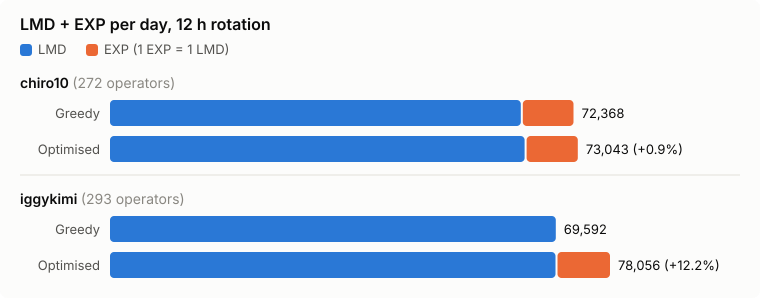
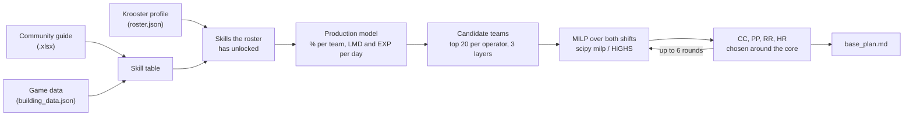

# Arknights-Base

[](LICENSE)

A planner that reads a player's Arknights roster and picks, with mixed-integer linear programming,
which characters to put in which room of their in-game base to get the most resources per day.

In the game Arknights, each player owns a few hundred characters called operators and runs a base
(RIIC) with factories, trading posts, power plants and other rooms. Every room takes one to five
operators, and the base is usually run in two 12-hour shifts, because operators get tired and must
rest in the dormitories. Many operators have a base skill that raises the output of the room they
work in, often only next to certain partners. Factories make either gold or EXP. Trading posts turn
gold into LMD, the game's currency. Power plants speed up drones, which make one trading post
faster. A factory that makes EXP is a factory that makes no gold, so
the base trades EXP against LMD.

That makes it an assignment problem with interactions. In a roster of 293 operators, 53 have a
factory skill and 47 a trading-post skill: about 23,000 possible factory teams and 16,000
trading-post teams. A plan picks 12 of them across two shifts, and no operator can be in two. A
team's output depends on who else is in it and on the control center buffs. The gold the factories
make caps the LMD the trading posts can sell. Filling the rooms one at a time with the best team
left gives a worse plan, so the planner solves both shifts in one integer program.

## Results

<picture>
  <source media="(prefers-color-scheme: dark)" srcset="docs/figures/plan-vs-greedy-dark.svg">
  
</picture>

Plans for the two rosters in [`players/`](players), both on the default 2-4-3 layout (2 trading
posts, 4 factories, 3 power plants). Figures are per day with the two shifts rotating every 12 h.

| Player | Operators | LMD/day | EXP/day | Shift A | Shift B |
|---|---|---|---|---|---|
| iggykimi | 293 | 69,856 | 8,200 | 65,078 LMD + 16,400 EXP | 74,633 LMD |
| chiro10 | 272 | 65,043 | 8,000 | 61,910 LMD + 16,000 EXP | 68,175 LMD |

In both plans the trading posts sell all the gold the factories make (116.0 of 116.0 bars a day in
iggykimi's shift A, 149.3 of 149.3 in shift B). The best trading post is iggykimi's Proviso team in
shift B at +176.2%. Each plan takes about 4 minutes to build.

The chart compares the plan with a greedy baseline. The greedy plan keeps the same control center,
power plants, reception and HR office, and refills only factories and trading posts: shift A first,
taking the best remaining team each time, with a bar of gold valued at 500 LMD. For iggykimi the
greedy plan puts gold in all four factories of both shifts. Its LMD is only 0.4% lower, so the
gold from the fourth factory in shift A mostly goes unsold. The MILP makes EXP there instead, for
+12.2% in total. For chiro10 the gap is +0.9%. The script is [`scripts/figures.py`](scripts/figures.py) and the
numbers are in [`docs/figures/results.json`](docs/figures/results.json).

## How it works



### Data

There are three sources:

1. `players/<user>/roster.json`: what Krooster stores, keyed by character id. Names come from the
   game data and the guide, so alters and variants resolve on their own.
2. The [Arknights Base Combo Guide](#data-and-credits) workbook: skills by promotion level (elite)
   and the formulas for the special teams (Vermeil, Mizuki, Shamare, Proviso and others). Every
   formula in the code cites the cell it comes from.
3. The EN game data (`building_data.json`, `character_table.json`), downloaded once to `.cache/`
   and pinned to a commit. It fills in what the guide does not list (weak skills, E0 versions) and
   is used to check the guide.

### Production per day

Gold: 20 bars at +0% (72 min per bar). EXP: 8,000 (Tactical Battle Record, 1,000 EXP in 3 h).
Trading posts: orders of 2, 3 and 4 gold at 30, 50 and 20%, 500 LMD per gold. Proviso raises the LMD
of each order by ×1.55 on average, and Closure replaces them with her own (1,200 LMD for 2 gold in
144 min).

Drones: one every 6 min plus whatever the power plants add, each worth 3 min of work
(`laborRecoverTime` and `tradingReduceTimeUnit` in the game data), all sent to one trading post.
With no bonus they add half a day to that post, and they need gold too. If the trading posts ask for
more gold than the factories make, they sell less.

### Rules

A skill only counts if the operator has reached its elite and level. Buffs of the same kind do not
stack: only the highest applies. Proviso does not work with Tequila or with operators who improve
orders. Ramps ("+20%, rising 1% per hour") count as their 12 h mean, as the guide does.

### Optimisation

Factories and trading posts of both shifts are chosen together in one mixed-integer linear program
(`scipy.optimize.milp`, HiGHS):

- One binary variable per candidate team and shift; each operator works in one place at most.
- Each shift sells only the gold it makes: LMD sold is a continuous variable, bounded by the trading
  post's capacity and by the shift's gold.
- Each trading-post team has a twin that takes the shift's drones (at most one per shift), so
  choosing which post gets them stays linear.
- Candidates: the 20 best teams of each operator, in three layers. Each layer is computed without the
  members of the previous layer's best teams, so shift B still has teams left without shift A's
  stars.

Power plants, control center (CC), reception room and HR office are chosen around that core, and the
whole repeats for up to six rounds from two starting points. The CCs of both shifts are chosen
together, so a band like Ave Mujica is not split across shifts. The best plan seen is kept.

Putting the CC inside the integer program is exact, but it was tried and gave worse plans: HiGHS
could not close the gap within the time limit. Free CC slots go first to operators who speed up clues
or HR, then to those who reduce morale drain. Morale is not optimised; the planner only checks that
each operator lasts their shift.

## Validation

The tests check the model against sources other than the code itself. They use frozen copies of the
rosters (`tests/data/`), so a new promotion does not break them.

Against the game. For each operator and room, the % the model uses equals the game's (about 100
combinations), and every number read from the guide appears in the game's skill text. Drones come
from `building_data.json`: 240 a day, 3 min of work each.

Against the guide. The model reproduces the team results the workbook publishes: Mizuki + 2 Standard
+90%, Proviso with two 30% workers +153.79%, Shamare +110.08%, Bubble +90–95%, Dorothy +95%, Penguin
Logistics +100%, Exusiai Alter + Archetto + Lemuen +115%, Reserve A1 +70–85%, and the reception room
pairs.

Against the rosters. Every owned operator has skills (Krooster writes "Varkáris" and the guide
"Valkáris": the old text parser dropped her without a warning), no operator is in two places, both
shifts fill every room, and every name in the rules exists.

Two numbers exist only in the guide and cannot be checked against the game: Closure's order values
(NEW!F23) and Exusiai Alter triggering Lemuen's +25% (TP!B241).

## Limits

- The solver stops within 0.1% of the optimum, and choosing production and CC in rounds does not
  guarantee the global optimum.
- Not modelled: Jaye's conditional team, Alanna (robots produce less in the power plants than she
  adds), SilverAsh Alter (needs 3 Kjerag operators in one trading post), the Worldly Plight and
  Perception Information teams, and clue bias.
- Assumptions: rooms at max level, dormitories at level 5, ambience >4k, EN server (235 drone
  capacity).
- Morale hours can come out slightly short: if the guide repeats a skill on two sheets (Almond), its
  morale cost is added twice. This only affects the "Horas" (hours) column.

## Usage

Python 3.12 or later.

```bash
pip install numpy openpyxl scipy pytest
# download the guide workbook first (see below)
python -m riic                   # fetch every roster from Krooster and rebuild every plan
python -m riic chiro10           # one player
python -m riic new_user          # add a player: creates players/new_user/
python -m riic --no-fetch        # rebuild the plans from the saved rosters
python -m pytest -q              # tests (~9 min)
```

The guide workbook is not in this repo. Open the
[Arknights Base Combo Guide](https://docs.google.com/spreadsheets/d/1zYc2JU46X0XWmV7s1503bN4feRdOMa1eehrTQ2jGaiE),
choose File > Download > Microsoft Excel (.xlsx), and save it at the repo root as
`Arknights Base Combo Guide.xlsx` (it is gitignored). You can also point `RIIC_WORKBOOK` or
`--excel` at another path. Without it the planner exits with that message, and the tests that need
it are skipped. The cell references in the code and tests match the copy downloaded in October
2026; a newer version may move them.

Each plan takes about 4 minutes. The Krooster profile must be public.

### Per-player settings

Anything other than the default goes in `players/<user>/settings.json`, for
example `{"layout": "252", "office_level": 2}`. The same settings as command-line options apply to
that run only:

- `layout` (`--layout 243|252|333|342`): number of trading posts, factories and power plants.
  Default 243.
- `office_level` (`--office-level N`): affects Entelechia and Mr.Nothing. Default 3.
- `exp_weight` (`--exp-weight X`): how many LMD 1 EXP is worth. Default 1, since CE-5 and LS-5 give
  the same per sanity.
- `gold_facs` (`--gold-facs N`): fixes how many factories make gold in each shift. For a specific
  gold/EXP split, use this rather than raising `exp_weight`: with a fixed value per resource the
  optimiser goes to the extremes.

`python -m riic.promotions <user>` estimates how much the base would gain from promoting each
operator (takes over an hour). `python scripts/figures.py` rebuilds the chart above.

## Structure

```
players/<user>/     roster.json (Krooster), settings.json (optional), base_plan.md, skills_owned.csv
riic/__main__.py    python -m riic: downloads rosters and writes the plans
riic/krooster.py    download of a public Krooster profile
riic/roster.py      roster reader
riic/excel.py       skills and formulas from the guide
riic/gamedata.py    game data: names and skills the guide does not list
riic/model.py       formulas and daily production
riic/optimize.py    team selection
riic/promotions.py  python -m riic.promotions <user>: gain from each promotion
scripts/figures.py  the README chart, optimised plan vs greedy
tests/              checks against the game, the workbook and the rosters
```

The generated plans (`base_plan.md`, `skills_owned.csv`) are in Spanish, the language the planner
was first written for.

## How it was built

The code was written with AI coding agents. [`AGENTS.md`](AGENTS.md) is the instruction file they
work from. I set the modelling rules and checked every formula against the guide and the game data;
the validation tests above come from that.

## Data and credits

- Rosters: [Krooster](https://www.krooster.com/), from public player profiles.
- Base skills and team formulas: the
  [Arknights Base Combo Guide](https://docs.google.com/spreadsheets/d/1zYc2JU46X0XWmV7s1503bN4feRdOMa1eehrTQ2jGaiE)
  by phlegyas, blackgatoacer and AKO's #r-i-i-c regulars, with trading-post calculations by
  optima. The workbook is theirs and is not redistributed here.
- Game data: [ArknightsAssets/ArknightsGamedata](https://github.com/ArknightsAssets/ArknightsGamedata),
  EN server tables.

Arknights and all game content belong to Hypergryph and Yostar. This project is not affiliated with
them. The MIT license covers the code in this repo only.
